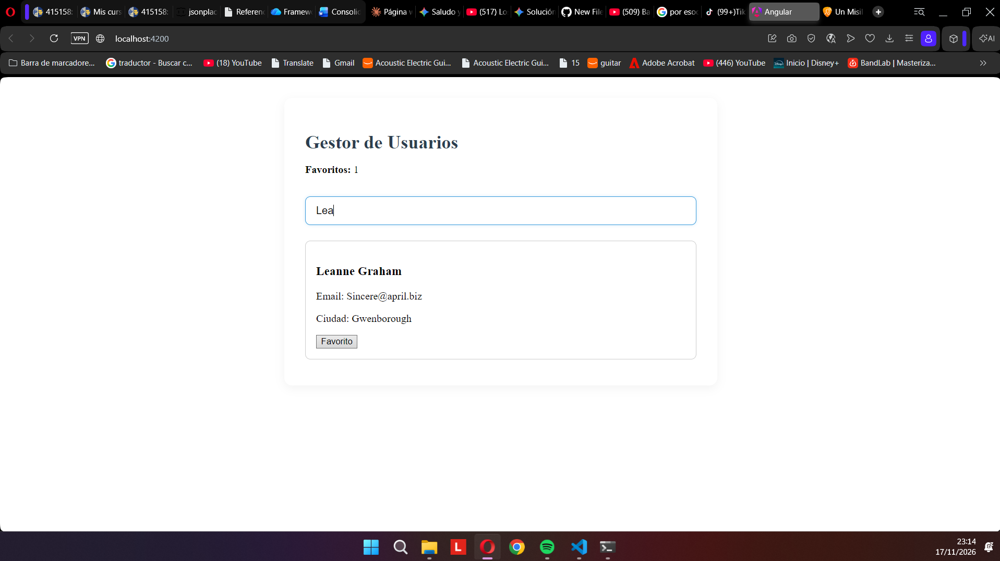
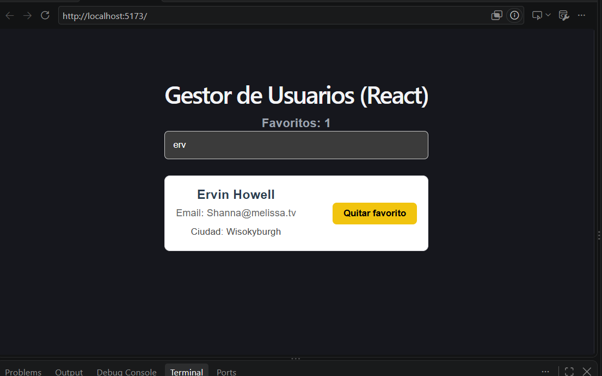

# Gestor de Usuarios — Comparativa Angular y React

Aplicación web desarrollada en dos frameworks distintos (**Angular** y **React**) como actividad académica comparativa. Ambas implementaciones consumen la API pública de JSONPlaceholder (`https://jsonplaceholder.typicode.com/users`) e incluyen estados de carga y error, buscador en tiempo real por nombre, tarjetas reutilizables, sistema de favoritos con contador dinámico y pruebas unitarias.

---

## Estructura del Repositorio

```text
/
├── gestor-angular/    # Implementación en Angular
├── gestorReact/       # Implementación en React (Vite)
└── README.md          # Documentación, comandos y evidencias
```

---

## Requisitos Previos

* **Node.js** instalado (v22.22.3 o superior recomendado).
* Gestor de paquetes **npm**.

---

## Proyecto 1: Angular

### 1. Instalación de dependencias
Ingresa a la carpeta del proyecto en Angular e instala los paquetes necesarios:
```bash
cd gestor-angular
npm install
```

### 2. Ejecución en desarrollo
Levanta el servidor local:
```bash
ng serve
```
Abre tu navegador en: `http://localhost:4200`.

### 3. Pruebas Unitarias
Ejecuta las pruebas unitarias configuradas:
```bash
npx ng test --watch=false
```

### 4. Compilación (Build)
Para generar la versión de producción en `dist/gestor/browser`:
```bash
npm run build
```

---

## Proyecto 2: React (Vite)

### 1. Instalación de dependencias
Ingresa a la carpeta del proyecto en React e instala los paquetes:
```bash
cd gestorReact
npm install
```

### 2. Ejecución en desarrollo
Levanta el servidor de desarrollo con Vite:
```bash
npm run dev
```
Abre tu navegador en: `http://localhost:5173`.

### 3. Pruebas Unitarias
Ejecuta las pruebas unitarias con Vitest:
```bash
npx vitest run
```

### 4. Compilación (Build)
Para generar la versión de producción en `dist`:
```bash
npm run build
```

---

## Evidencias de Funcionamiento

### 1. Aplicación en Angular
* **Vista principal, filtrado y favoritos:**
  
* **Ejecución de pruebas unitarias:**

### 2. Aplicación en React
* **Vista principal, filtrado y favoritos:**
  
* **Ejecución de pruebas unitarias:**
